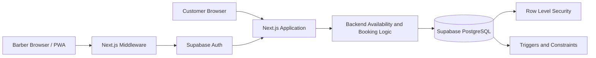

# JSL Barber Booking

A full-stack appointment booking application built for a local barbershop client. Customers can book appointments without creating an account, while the barber manages appointments, business hours, availability, and services through a protected administrative dashboard.

The application was designed with a mobile-first experience and delivered as an installable Progressive Web App (PWA).

**Tech Stack:** Next.js (App Router), TypeScript, React, Tailwind CSS v4, shadcn/ui, Supabase, PostgreSQL, Vercel

Link: https://jslbarber.vercel.app/

## Features

### Customer Booking

- Guest booking flow requiring no customer account.
- Guided appointment process: service selection, date and time selection, and customer information.
- Dynamic availability based on business hours, recurring breaks, blocked time, existing appointments, and service duration.
- Booking confirmation with add-to-calendar support through downloadable `.ics` files and Google Calendar.
- Installable PWA with an installation experience for supported devices.

### Administrative Dashboard

- Dashboard displaying today's and upcoming weekly appointments.
- Appointment management with convenient phone and text contact actions.
- Weekly business hours and recurring break management.
- One-time availability blocking with conflict checks against existing appointments.
- Service and pricing management.
- Protected administrative access with persistent login support.

## How Availability Works

The availability engine in `lib/availability.ts` calculates appointment slots dynamically rather than relying on a pre-generated list of available times.

For a selected date and service, the application:

1. Retrieves the barber's weekly availability for the selected weekday.
2. Generates appointment start times at 15-minute intervals, ensuring the selected service fits within business hours.
3. Calculates each appointment's end time using the selected service duration.
4. Filters out slots that overlap recurring breaks, blocked periods, or existing appointments.
5. Excludes appointment times that have already passed on the current day.

Time conflicts are evaluated using interval-overlap logic:

`slotStart < otherEnd AND slotEnd > otherStart`

This allows back-to-back appointments while preventing overlapping time intervals.

Availability is calculated on request, so the application does not need to maintain a separate table of pre-generated appointment slots.

## Architecture



### Project Structure

```text
app/             Application routes and pages
components/      Reusable UI components
components/install/ PWA installation experience
lib/             Availability logic, date/time helpers,
                 calendar export, and Supabase clients
middleware.ts    Administrative route protection
supabase/        Database schema and SQL definitions
```

## Engineering Decisions

### Database-Level Booking Integrity

Frontend validation alone cannot prevent two customers from attempting to book the same appointment at nearly the same time.

To address this, PostgreSQL enforces appointment integrity through an exclusion constraint on appointment time ranges. The constraint prevents overlapping bookings while allowing back-to-back appointments.

A `BEFORE INSERT` trigger also performs server-side validation, checks appointment timing against the shop's local time zone (`America/Los_Angeles`), and derives the appointment end time from the selected service duration.

This makes the database the final authority for preventing conflicting appointments rather than relying exclusively on browser-side checks.

### Authentication and Authorization

The application separates authentication from authorization.

- Supabase Auth handles administrative authentication.
- Next.js middleware validates the user's session and protects administrative routes.
- PostgreSQL Row Level Security (RLS) policies enforce data access permissions at the database level.
- Administrative operations are restricted to authorized users, while public customers can access the booking functionality without creating accounts.

### Preserving Appointment History

Appointment records retain their original duration and timing information when created.

The booking data model intentionally avoids coupling historical appointments to mutable service records through a foreign key. This prevents changes to service durations or the deletion of a service from altering previously created appointments.

### Handling Date and Time Correctly

Appointment dates and times are stored using PostgreSQL `date` and `time` types and interpreted in the barbershop's local time zone.

Date handling uses local date components rather than relying on UTC conversions that can shift calendar dates in Pacific Time.

### Handling Row Level Security

RLS policies can reject database writes without necessarily returning a conventional database error.

The application checks returned records when performing relevant writes so that an operation returning zero rows is not incorrectly treated as a successful update.

### Progressive Web App Design

The application supports installation through a web app manifest and custom installation experience.

It does not rely on a service worker to cache application responses. This keeps availability and booking information from being presented as cached data.

## Known Limitations

- Business hours, recurring breaks, and blocked periods are validated by application logic; database-level overlap protection applies to bookings.
- Availability blocking is checked against existing appointments by the application. A simultaneous booking and blocking operation is not protected by a database-level constraint.
- Anonymous booking submissions do not currently use rate limiting or CAPTCHA.
- Customer self-service cancellation and rescheduling are not implemented.
- Automated appointment reminders are not implemented; customers can add appointments to their calendars.
- The application is designed for a single barber rather than a multi-tenant booking platform.

## Running Locally

1. Clone the repository.
2. Install dependencies:

   ```bash
   npm install
   ```

3. Create a Supabase project and configure the database tables, relationships, policies, constraints, and triggers.

4. Create a `.env.local` file with your Supabase project credentials:

   ```env
   NEXT_PUBLIC_SUPABASE_URL=your_supabase_url
   NEXT_PUBLIC_SUPABASE_PUBLISHABLE_KEY=your_publishable_key
   ```

5. Configure an authorized administrative user in Supabase.

6. Start the development server:

   ```bash
   npm run dev
   ```
